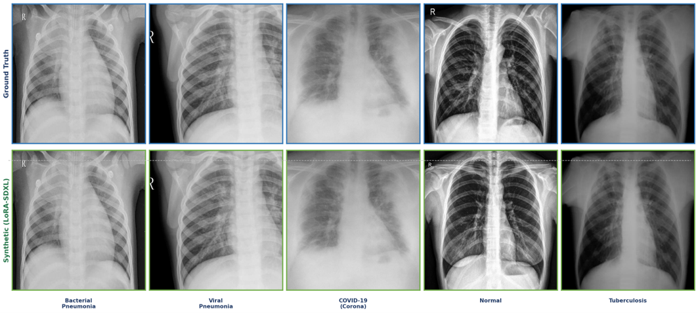

# Privacy-Preserving Synthetic Medical Imaging Using LoRA-Enhanced Diffusion Models for Multi-Class Lung Disease Diagnosis


*Ground-truth patient CXRs (top) vs. LoRA-SDXL synthetic counterparts (bottom) across five classes.*

---

## Table of Contents

1. [Abstract](#abstract)
2. [Key Highlights](#key-highlights)
3. [Contributions](#contributions)
4. [Methodology](#methodology)
5. [Experimental Setup](#experimental-setup)
6. [Results Summary](#results-summary)
7. [Discussion](#discussion)
8. [Conclusion](#conclusion)
9. [Limitations and Future Work](#limitations-and-future-work)
10. [Code and How to Run](#code-and-how-to-run)
11. [Repository Structure](#repository-structure)
12. [Contact](#contact)

Full results, tables and figures are in [`results/README.md`](results/README.md).  
Code and run instructions are in [`codes/README.md`](codes/README.md).

---

## Abstract

Acquiring annotated medical imaging datasets is difficult, and privacy regulations such as **HIPAA** and **GDPR** make it harder still. This is a major barrier to building accurate deep learning models for automated diagnosis of respiratory disease.

This work proposes a **privacy-preserving framework** that uses **Low-Rank Adaptation (LoRA)-augmented Stable Diffusion XL (SDXL)** to generate high-quality chest X-ray (CXR) images across five clinically relevant classes: **bacterial pneumonia, viral pneumonia, COVID-19, tuberculosis and normal**. Images are synthesised at **1024 × 1024** resolution using LoRA rank **r = 128**, trained for **50 epochs**.

Three CNN architectures, **ResNet50, InceptionV3 and Xception**, are evaluated on hybrid real + synthetic data, on synthetic data trained from scratch, and on synthetic data with ImageNet pre-trained weights. **Xception** performs best, reaching **98.94%** accuracy on the hybrid dataset and **93.31%** with pre-trained weights. Image quality metrics (**SSIM = 0.92, PSNR = 28.9 dB**) show that LoRA-generated images are substantially better than GAN-generated images.

**Keywords:** LoRA Diffusion Model · CNNs · Privacy-Preserving AI · Chest X-ray Synthesis · Transfer Learning

---

## Key Highlights

- **Classes:** bacterial pneumonia, viral pneumonia, COVID-19, tuberculosis and normal
- **Synthesis:** LoRA-SDXL at 1024 × 1024 px
- **Privacy:** only ~2.1M of ~25M parameters are updated on real patient data
- **Best accuracy:** Xception, 98.94% (hybrid) and 93.31% (synthetic + ImageNet weights)
- **Image quality:** SSIM 0.92, PSNR 28.9 dB, FID ~38
- **vs. GAN baseline:** +48.4% relative SSIM improvement
- **Clinical check:** 100% diagnostic realism acceptance by an MBBS physician

---

## Contributions

1. **Privacy-preserving LoRA-SDXL synthesis pipeline** generating 1024 × 1024 CXRs for five disease classes while updating only ~2.1M parameters on real data, giving implicit Gaussian Differential Privacy (GDP)-consistent protection without DP-SGD.
2. **First three-condition comparison** of ResNet50, InceptionV3 and Xception (hybrid dataset, no pre-trained weights, ImageNet pre-trained weights) on LoRA-synthesised pulmonary data.
3. **Statistical validation** using paired t-tests and Wilcoxon signed-rank tests over five-fold stratified cross-validation.
4. **Quantitative and qualitative image-quality validation** (SSIM, PSNR, FID), with a 48.4% SSIM improvement over GAN baselines and physician review of clinical realism.

---

## Methodology

### Dataset Composition

- Public CXR data from Kaggle repositories drawing on the **NIH ChestX-ray14** dataset, the **COVID-19 Radiography Database** and the **Montgomery County TB** collection.
- Five mutually exclusive classes: bacterial pneumonia, viral pneumonia, COVID-19, tuberculosis and normal.
- Labels encoded with a stratified `LabelEncoder` (`random_state = 42`), serialised to `.pkl` for consistent class mapping across folds.

### Preprocessing

| Model | Input size | Normalisation |
|---|---|---|
| ResNet50 | 224 × 224 | ResNet preprocessing (BGR mean subtraction) |
| InceptionV3 | 299 × 299 | Scaled to [−1, 1] |
| Xception | 299 × 299 | Scaled to [−1, 1] |

### Data Augmentation

- Rotation ±30°, width/height shift 0.3, shear 0.3, zoom 0.3
- Brightness [0.8, 1.2], random horizontal flip, `fill_mode = 'nearest'`
- Validation and test sets: preprocessing only, no augmentation
- LoRA fine-tuning: augmentation on 70% of batches, 2× oversampling of TB and COVID-19

### GAN Baselines (SMGAN / SRGAN)

Initial experiments with style-modulated GAN (SMGAN) and super-resolution GAN (SRGAN) gave poor quality (**SSIM = 0.62, PSNR = 21.4 dB**), with rib-cage distortion, blurred lung fields and mode collapse. This motivated the move to diffusion.

### LoRA-SDXL Synthetic Generation Pipeline

| Hyperparameter | Value |
|---|---|
| LoRA rank *r* | 128 |
| LoRA α | 128 |
| Epochs | 50 |
| Learning rate | 1 × 10⁻⁴ with 500-step linear warm-up |
| Batch size | 16 |
| Optimiser | 8-bit Adam |
| Resolution | 1024 × 1024 |
| Diffusion timesteps *T* | 1000 |
| Sampler | DDIM, 200 steps (deterministic) |
| LoRA targets | Query, key, value and output attention projections |
| Trainable parameters | ~2.1M of ~25M |
| Quality filter | Physician-validated, SSIM threshold 0.85 |

LoRA injects low-rank matrices into the frozen weights, **W = W₀ + BA**, where B is initialised to zero so that the adapted model starts identical to the pre-trained one. At high timesteps, the forward diffusion process acts as a Gaussian mechanism satisfying µ-GDP (following *dp-promise*), so privacy protection is obtained without extra DP-SGD noise.

### CNN Classifiers

- **ResNet50**: residual learning with bottleneck blocks
- **InceptionV3**: factorised and asymmetric convolutions with multi-scale Inception modules
- **Xception**: depthwise separable convolutions (~9× fewer parameters for C_out = 256, K = 3)

**Shared classification head:**
`GAP → Dense(512, ReLU) → Dropout(0.5) → Dense(256, ReLU) → Dropout(0.3) → Dense(5, Softmax)`

---

## Experimental Setup

### Training Protocol

| Setting | Value |
|---|---|
| Loss | Class-weighted categorical cross-entropy |
| LR schedule | Cosine annealing, η₀ = 1 × 10⁻⁴, T = 30 epochs |
| Plateau handling | ReduceLROnPlateau (factor 0.2, patience 3) |
| Fine-tuning | Last 100 layers unfrozen (pre-trained setting) |
| Cross-validation | 5-fold stratified |
| Batch size | 32 |

### Experimental Conditions

| Group | Training data | Initialisation | Test set |
|---|---|---|---|
| **1. Hybrid** | 50% real + 50% synthetic | ImageNet | Synthetic test set |
| **2. Synthetic only, no pre-train** | Synthetic | Random (from scratch) | Real public held-out set |
| **3. Synthetic only, with pre-train** | Synthetic | ImageNet | Real public held-out set |

### Evaluation Metrics

- **Classification:** accuracy, precision, recall, F1 (one-vs-rest), ROC/AUC
- **Image quality:** SSIM, PSNR, FID
- **Statistics:** paired t-test, Wilcoxon signed-rank test on fold-wise accuracies

---

## Results Summary

> Full tables, per-class analysis and all figures are in **[`results/README.md`](results/README.md)**.

### Image Quality: GAN vs. LoRA Diffusion

| Metric | GAN (SMGAN/SRGAN) | **LoRA Diffusion (SDXL)** |
|---|---|---|
| SSIM ↑ | 0.62 | **0.92** |
| PSNR (dB) ↑ | 21.4 | **28.9** |
| FID ↓ | ~142 | **~38** |
| Resolution | 512 × 512 | **1024 × 1024** |
| Clinical acceptance | 40% | **100%** |

### Classification Accuracy

| Condition | ResNet50 | InceptionV3 | **Xception** |
|---|---|---|---|
| Hybrid (50% real + 50% synthetic) | 94.76% | 91.53% | **98.94%** |
| Synthetic only, no pre-train | 85.23% | 81.38% | **87.81%** |
| Synthetic only, with pre-train | 89.13% | 90.88% | **93.31%** |

**Xception is the best model in every condition**, with statistically significant superiority over InceptionV3 without pre-training (t = −3.82, p = 0.019).

---

## Discussion

- **Diffusion beats GANs.** Iterative denoising builds global structural coherence, while a GAN generator must satisfy the discriminator in one forward pass, which produces texture artefacts.
- **Implicit privacy.** Only the ~2.1M LoRA attention parameters see real CXR data, which mirrors the non-private high-timestep phase of *dp-promise* and shrinks the membership-inference attack surface.
- **Why Xception wins.** Depthwise separable convolutions give strong discriminative power with fewer parameters, so the model generalises better and overfits less.
- **Viral pneumonia is the hardest class.** Its features are largely high-frequency, which, per DCTdiff's spectral-autoregression view, are reconstructed last during reverse diffusion and are most prone to synthesis error.

---

## Conclusion

The framework combines LoRA-SDXL synthetic image generation with a systematic CNN comparison across five pulmonary disease classes. LoRA-SDXL produces clinically validated 1024 × 1024 CXRs (SSIM 0.92, PSNR 28.9 dB) that clearly outperform GAN baselines. Xception achieves the highest accuracy in all conditions, and restricting real-data exposure to ~2.1M LoRA parameters provides an implicit privacy benefit consistent with *dp-promise*.

---

## Limitations and Future Work

### Limitations

1. Viral pneumonia F1 remains the lowest class score because of radiological overlap with COVID-19 and interstitial patterns.
2. Formal (ε, δ)-DP bounds for LoRA fine-tuning have not been computed.
3. Clinical validation is limited to a single MBBS physician; no multi-centre radiologist study yet.

### Future Directions

1. Formal two-phase GDP accounting of LoRA fine-tuning using *dp-promise*.
2. DCT-space diffusion to better reconstruct high-frequency pathological textures.
3. Higher-rank LoRA (r = 256–512) with viral-pneumonia-specific prompts.
4. Multi-centre radiologist evaluation across diverse patient demographics.
5. Extension to volumetric CT synthesis with 3D diffusion models.
6. Further hybrid real–synthetic studies to characterise the synthetic-to-real gap.

---

## Code and How to Run

Full instructions: **[`codes/README.md`](codes/README.md)**

```bash
cd codes
pip install -r requirements.txt

# 1. synthetic images (LoRA-SDXL)
python synthetic_image_generation/LoRA_SDXL/prepare_dataset.py --real_dir data/real_train
bash   synthetic_image_generation/LoRA_SDXL/train_lora_sdxl.sh
python synthetic_image_generation/LoRA_SDXL/generate_images.py --lora_dir synthetic_image_generation/LoRA_SDXL/outputs/lora_weights

# 2. train classifiers
bash code_with_weights/train_all.sh    data/synthetic_train
bash code_without_weights/train_all.sh data/synthetic_train

# 3. test on the real held-out set
bash Test/test_with_weights/test_all.sh    data/real_test
bash Test/test_without_weights/test_all.sh data/real_test
```

| Folder | What it contains |
|---|---|
| [`codes/synthetic_image_generation/LoRA_SDXL`](codes/synthetic_image_generation/LoRA_SDXL) | Proposed LoRA-SDXL pipeline |
| [`codes/synthetic_image_generation/SRGAN`](codes/synthetic_image_generation/SRGAN) | SRGAN baseline with SSIM, PSNR, SNR |
| [`codes/synthetic_image_generation/SMGAN`](codes/synthetic_image_generation/SMGAN) | SMGAN baseline with SSIM, PSNR, SNR |
| [`codes/code_with_weights`](codes/code_with_weights) | ResNet50 / InceptionV3 / Xception training with ImageNet weights |
| [`codes/code_without_weights`](codes/code_without_weights) | The same three models trained from scratch |
| [`codes/Test`](codes/Test) | Matching test scripts, statistical tests and summary table |

---

## Repository Structure

```
.
├── README.md                      ← Paper overview (this file)
├── results/
│   └── README.md                  ← Full results, tables and analysis
├── figures/                       ← Figures from the paper
└── codes/
    ├── README.md                  ← How to run everything
    ├── requirements.txt
    ├── common/                    ← Shared config, data, models, metrics
    ├── synthetic_image_generation/
    │   ├── LoRA_SDXL/
    │   ├── SRGAN/
    │   ├── SMGAN/
    │   └── image_quality_evaluation/
    ├── data_preparation/          ← Hybrid (50% real + 50% synthetic) builder
    ├── code_with_weights/
    │   ├── ResNet50/  InceptionV3/  Xception/
    ├── code_without_weights/
    │   ├── ResNet50/  InceptionV3/  Xception/
    └── Test/
        ├── test_with_weights/
        │   ├── ResNet50/  InceptionV3/  Xception/
        ├── test_without_weights/
        │   ├── ResNet50/  InceptionV3/  Xception/
        ├── statistical_tests.py
        └── summarize_results.py
```

---

## Contact

- **Umair Zaheen**: umairzaheen111@gmail.com
