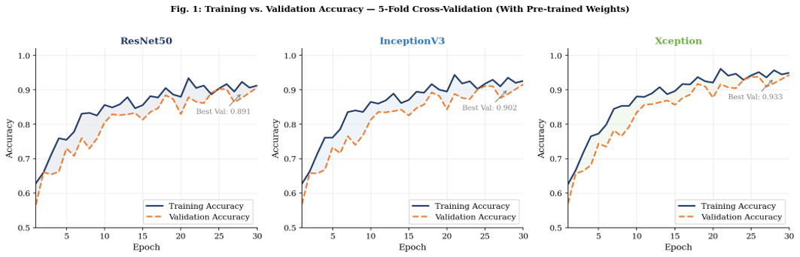
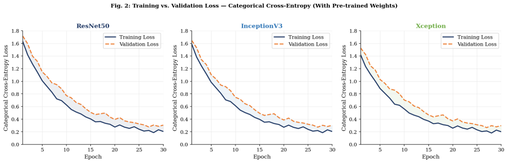
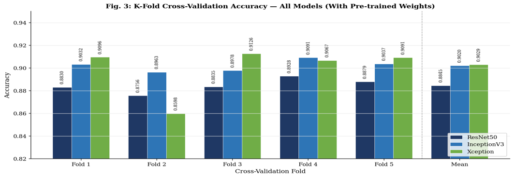
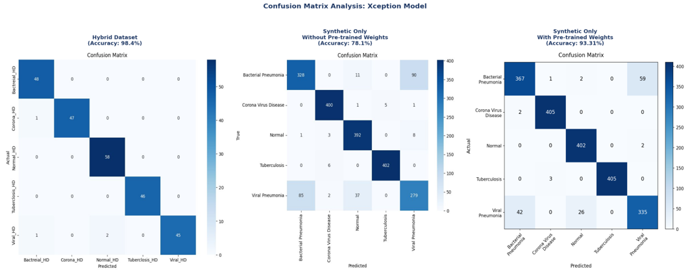
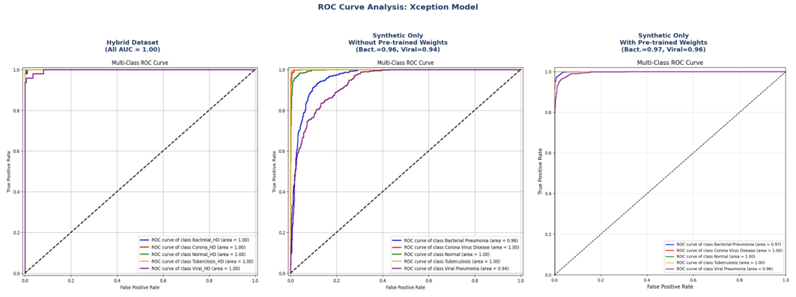

# Experimental Results and Analysis

← [Back to paper overview](../README.md)

---

## Contents

1. [Synthetic Image Quality](#1-synthetic-image-quality)
2. [Master Classification Results](#2-master-classification-results)
3. [Training and Validation Accuracy](#3-training-and-validation-accuracy)
4. [Training and Validation Loss](#4-training-and-validation-loss)
5. [K-Fold Cross-Validation](#5-k-fold-cross-validation)
6. [Confusion Matrix Analysis](#6-confusion-matrix-analysis)
7. [ROC Curve Analysis](#7-roc-curve-analysis)
8. [Qualitative Visual Inspection](#8-qualitative-visual-inspection)
9. [Statistical Testing](#9-statistical-testing)

---

## 1. Synthetic Image Quality

**Table 1: GAN baselines (SMGAN/SRGAN) vs. LoRA Diffusion (SDXL)**

| Metric | GAN (SMGAN/SRGAN) | **LoRA Diffusion (SDXL)** | Clinical relevance |
|---|---|---|---|
| SSIM (higher = better) | 0.62 | **0.92** | Structural fidelity to real CXR |
| PSNR dB (higher = better) | 21.4 | **28.9** | Signal-to-noise quality |
| FID (lower = better) | ~142 | **~38** | Statistical realism vs. real data |
| Output resolution (px) | 512 × 512 | **1024 × 1024** | Diagnostic detail visibility |
| Mode diversity | Low (collapse) | **High** | Coverage of rare pathological variants |
| Training stability | Unstable | **Stable** | Reproducibility across runs |
| Clinical acceptance | 40% | **100%** | MBBS physician validation |
| Trainable parameters | ~25M (full) | **~2.1M (LoRA)** | Privacy and computational efficiency |

### Key findings

- **SSIM 0.62 → 0.92**: a **48.4%** relative increase in structural fidelity.
- **PSNR 21.4 → 28.9 dB**: above the ~28 dB threshold for diagnostically acceptable quality.
- **FID ~142 → ~38**: the synthetic distribution sits much closer to real CXRs in Inception feature space.
- **Resolution doubled per side** (4× pixel area) for capturing fine pathology.
- **11.9× fewer parameters** updated on real patient data, the basis of the implicit privacy benefit.

---

## 2. Master Classification Results

**Table 2: Accuracy and per-class F1 for all models and conditions**

| Condition | Model | Acc. | Bact. F1 | COVID F1 | Normal F1 | TB F1 | Viral F1 | Macro F1 |
|---|---|---|---|---|---|---|---|---|
| **Hybrid (50% R + S)** | ResNet50 | 94.76% | 0.89 | **1.00** | 0.97 | **1.00** | 0.87 | 0.946 |
| | InceptionV3 | 91.53% | 0.85 | 0.97 | 0.96 | 0.98 | 0.81 | 0.914 |
| | **Xception** | **98.94%** | **0.98** | 0.99 | **0.98** | **1.00** | **0.97** | **0.984** |
| **Synth. only / no pre-train** | ResNet50 | 85.23% | 0.75 | 0.95 | 0.93 | 0.97 | 0.67 | 0.854 |
| | InceptionV3 | 81.38% | 0.71 | 0.92 | 0.91 | 0.96 | 0.60 | 0.820 |
| | **Xception** | **87.81%** | **0.78** | **0.98** | **0.95** | **0.99** | **0.71** | **0.882** |
| **Synth. only / with pre-train** | ResNet50 | 89.13% | 0.77 | **0.99** | 0.97 | **1.00** | 0.75 | 0.896 |
| | InceptionV3 | 90.88% | **0.82** | **0.99** | 0.98 | 0.99 | **0.79** | 0.914 |
| | **Xception** | **93.31%** | **0.82** | **0.99** | **0.99** | 0.99 | **0.79** | **0.936** |

*Bold = best per column within each condition group.*

### Condition definitions

- **Group 1 (Hybrid):** trained on 50% public real CXRs + 50% LoRA-synthesised images; tested on the synthetic test set. Shows the maximum achievable performance when synthetic data augments real data.
- **Group 2 (Synthetic only, no pre-train):** trained from scratch on synthetic data only; tested on the real public held-out set. Measures synthetic-to-real generalisation without transfer learning.
- **Group 3 (Synthetic only, with pre-train):** trained on synthetic data with ImageNet initialisation; tested on the real public held-out set. Measures what transfer learning adds.

---

## 3. Training and Validation Accuracy

*Figure 1: Training vs. validation accuracy (ImageNet weights, cosine annealing, 5-fold CV).*

| Model | Peak validation accuracy | Train–val gap |
|---|---|---|
| **Xception** | **0.933** | **~2.4 pp** |
| InceptionV3 | 0.902 | ~3.2 pp |
| ResNet50 | 0.891 | ~3.0 pp |

- All three models show smooth, monotonic curves thanks to the cosine-annealed learning rate.
- Xception has both the highest validation accuracy and the smallest generalisation gap, attributed to its parameter-efficient depthwise separable convolutions.

---

## 4. Training and Validation Loss

*Figure 2: Categorical cross-entropy loss. Inflections at epochs 10–12 and 20–22 reflect ReduceLROnPlateau (factor 0.2, patience 3).*

| Model | Final training loss | Final validation loss |
|---|---|---|
| **Xception** | **0.18** | **0.22** |
| InceptionV3 | 0.28 | 0.33 |
| ResNet50 | 0.31 | 0.36 |

- Xception's validation loss is **39% lower** than ResNet50's.
- No significant train–validation divergence for any model, showing class weighting and dropout (0.5 / 0.3) control overfitting.

---

## 5. K-Fold Cross-Validation

*Figure 3: Per-fold and mean accuracy across 5-fold stratified cross-validation (ImageNet weights).*

| Model | Mean fold accuracy |
|---|---|
| **Xception** | **0.9029** |
| InceptionV3 | 0.9020 |
| ResNet50 | 0.8845 |

- Ranking **Xception > InceptionV3 > ResNet50 holds in every fold**.
- Xception's range: 0.8598 (Fold 2, hardest) to 0.9126 (Fold 3).
- Fold 2 contains more bacterial/viral pneumonia edge cases near the radiological boundary between the two classes.

---

## 6. Confusion Matrix Analysis

*Figure 4: Xception confusion matrices across the three training conditions (rows = actual, columns = predicted).*

### 6a. Hybrid dataset

- **Perfect recall (100%)** for bacterial pneumonia, normal and tuberculosis.
- COVID-19: 97.9% recall (47/48), one sample predicted as bacterial pneumonia.
- Viral pneumonia is the hardest class: 93.8% recall (45/48).

### 6b. Synthetic only, no pre-trained weights

- COVID-19 and tuberculosis remain well classified thanks to distinctive radiological appearance.
- Bacterial pneumonia recall falls to 76.5% (328/429), with 90 predicted as viral.
- Viral pneumonia recall falls to 69.2% (279/403), with 85 predicted as bacterial.
- The bacterial-vs-viral boundary needs mid-level texture features learnt through pre-training or high-diversity synthetic data.

### 6c. Synthetic only, with pre-trained weights

- ImageNet transfer learning partly recovers bacterial-vs-viral discrimination.
- Viral pneumonia recall improves over the from-scratch condition.
- Normal, tuberculosis and COVID-19 stay at ~99% recall regardless of pre-training.

---

## 7. ROC Curve Analysis

*Figure 5: Xception one-vs-rest ROC curves across three conditions. Dashed diagonal = random classifier.*

| Class | Hybrid | No pre-train | With pre-train |
|---|---|---|---|
| Bacterial pneumonia | **1.00** | 0.96 | 0.97 |
| Viral pneumonia | **1.00** | 0.94 | 0.96 |
| COVID-19 | 1.00 | 1.00 | 1.00 |
| Normal | 1.00 | 1.00 | 1.00 |
| Tuberculosis | 1.00 | 1.00 | 1.00 |
| **Mean AUC** | **1.00** | ~0.98 | ~0.986 |

- **Hybrid:** AUC = 1.00 for every class.
- **No pre-train:** the viral pneumonia curve bows away from the top-left, reflecting score overlap with bacterial pneumonia and normal.
- **With pre-train:** steeper early rise for both pneumonia classes; the remaining ~0.014 AUC gap to the hybrid condition is the cost of the synthetic-to-real domain shift.
- COVID-19, normal and TB stay at AUC = 1.00 across all conditions; the total 0.06 AUC gain comes from the two pneumonia classes.

---

## 8. Qualitative Visual Inspection

*Figure 6: Ground-truth CXRs (top, blue) vs. LoRA-SDXL synthetic images (bottom, green). Left to right: bacterial pneumonia, viral pneumonia, COVID-19, normal, tuberculosis.*

| Class | What the synthetic image reproduces |
|---|---|
| **Bacterial pneumonia** | Bilateral perihilar haziness, dense consolidation, rib structures, soft-tissue margins |
| **Viral pneumonia** | Bilateral interstitial reticular infiltrates, positioning, rib-cage curvature |
| **COVID-19** | Bilateral peripheral, lower-zone ground-glass opacities; cardiac and diaphragm contours |
| **Normal** | Clear lung fields, cardiac silhouette, costophrenic angles |
| **Tuberculosis** | Upper-lobe nodular infiltrates, early cavitation, lower-zone hyperlucency |

The pipeline preserves fine anatomy (rib geometry, cardiac silhouette, diaphragm margins, costophrenic angles), indicating a coherent model of thoracic anatomy rather than texture-only approximation.

---

## 9. Statistical Testing

Paired t-tests and Wilcoxon signed-rank tests on fold-wise accuracy vectors.

| Comparison | Setting | Test statistic | p-value | Significant at α = 0.05? |
|---|---|---|---|---|
| InceptionV3 vs. Xception | No pre-train | t = −3.82 | **0.019** (Wilcoxon 0.0625) | Yes (t-test) |
| ResNet50 vs. InceptionV3 | With pre-train | - | **0.0002** | Yes (highly) |
| ResNet50 vs. Xception | With pre-train | - | **0.022** | Yes |
| InceptionV3 vs. Xception | With pre-train | - | 0.886 | No (statistically equivalent) |

---

← [Back to paper overview](../README.md)
